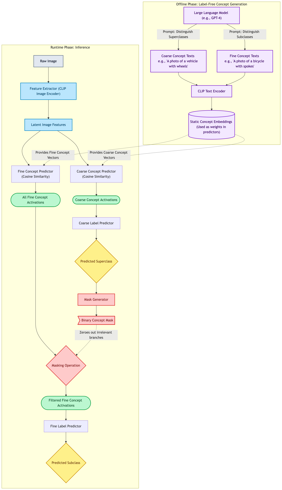

# Architecture Pipeline: Constrained Coarse-to-Fine Concept Bottleneck Model

This document explains the end-to-end pipeline of our proposed Constrained Coarse-to-Fine Concept Bottleneck Model (CBM). The architecture is divided into an **Offline Phase** (where concepts are generated without labels) and a **Runtime Phase** (where the hierarchical gating logic executes during inference).

---

## 1. Offline Phase: Label-Free Concept Generation
Before the model can process any images, we must define the bottleneck. In a Label-Free paradigm, this avoids expensive human annotation.
- **The LLM (e.g., GPT-4):** We query a Large Language Model twice. First, to generate distinguishing visual traits for all our superclasses (Coarse Concepts). Second, to generate distinguishing traits for the subclasses (Fine Concepts).
- **The Text Encoder (CLIP):** The generated text descriptions (e.g., "A photo of an animal with fur") are passed through CLIP's Text Encoder. 
- **The Result:** This produces static, numerical **Concept Embeddings**. These vectors are stored permanently and act as the logical "weights" for our concept predictors during runtime.

## 2. Runtime Phase: Image Feature Extraction
- **The Input:** A raw image is fed into the system.
- **The Feature Extractor:** A frozen Vision-Language image encoder (the image counterpart to the CLIP model used in the offline phase) processes the image. It outputs a high-dimensional vector representing the visual content of the image, known as the **Latent Image Features ($z$)**.

## 3. Runtime Phase: Level 1 (Coarse Prediction)
This level mimics a standard, flat CBM but operates exclusively on high-level, broad categories.
- **Coarse Concept Predictor:** Instead of a trained neural network layer, this predictor simply calculates the **Cosine Similarity** (dot product) between the Latent Image Features ($z$) and the static Coarse Concept Embeddings generated offline. 
- **Coarse Activations:** The result is a vector of probabilities indicating how strongly each coarse concept is present in the image (e.g., "has wheels: 0.9", "has fur: 0.01").
- **Coarse Label Predictor:** A trained, sparse linear layer takes these activations and predicts the final **Superclass** (e.g., *Vehicle*). 

## 4. Runtime Phase: The Dynamic Gating Mechanism
This is the core hierarchical mechanic that differentiates this architecture from a flat CBM.
- **The Trigger:** The predicted Superclass from Level 1 acts as a trigger.
- **The Mask:** The Mask Generator creates a binary vector (1s and 0s). Concepts that logically belong to the predicted superclass (e.g., *steering wheel*, *spokes*) receive a `1`. Concepts belonging to other superclasses (e.g., *gills*, *feathers*) receive a `0`.

## 5. Runtime Phase: Level 2 (Constrained Fine Prediction)
This level predicts the final specific subclass, but it is strictly constrained by the gate.
- **Initial Fine Activations:** First, the system calculates the Cosine Similarity between the Latent Image Features and *all* Fine Concept Embeddings.
- **The Filter (Masking Operation):** The binary mask from the gating mechanism is applied via element-wise multiplication. Any concept that received a `0` from the mask is instantly zeroed out, regardless of how strongly CLIP thought it was present in the image.
- **Filtered Fine Activations:** The resulting vector contains only logically consistent, active concepts (e.g., *spoked wheels* is active, *gills* is forced to 0).
- **Fine Label Predictor:** A second trained, sparse linear layer uses this cleanly filtered concept vector to make the final, highly interpretable **Subclass** prediction (e.g., *Bicycle*).
