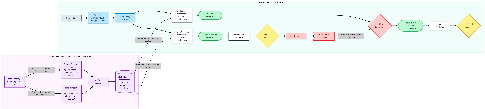

# Hierarchical Coarse-to-Fine Concept Bottleneck Models

[](https://www.overleaf.com/project/6a454543e7558b4d9ac7f8b5)

**Authors**: Francesco Pio De Dominicis and Luigi Marguglio (Politecnico di Torino)



This repository contains the implementation of a **Hierarchical Concept Bottleneck Model (Hier. CBM)**, developed for Explainable AI (XAI). The project leverages a hard-gating mechanism to enforce a rigorous taxonomy (Superclasses $\rightarrow$ Subclasses) during concept reasoning, effectively bridging the gap between concept and label hierarchies.

## 🧠 Methodology

Modern Concept Bottleneck Models (CBMs) typically rely on flat sets of concepts, ignoring natural taxonomic constraints (e.g., *is-a* or *part-of*). 
Our architecture implements a **Coarse-to-Fine Hard Gating** mechanism:
1. **Label-Free Concept Generation:** We use LLMs to extract separate dictionaries for *Coarse Concepts* (to differentiate superclasses) and *Fine Concepts* (to differentiate subclasses).
2. **Coarse Bottleneck:** The model first predicts one of the 20 Superclasses using only the Coarse Concepts.
3. **Hard Gating & Fine Prediction:** The predicted superclass acts as a mask, dynamically pruning (setting to zero) all logically incompatible Fine Concepts before final classification. 

This strict hierarchy ensures zero "catastrophic" mistakes across superclasses under an Oracle intervention setting.

## 📂 Project Structure

```text
.
├── data/                  # High-Resolution CIFAR-100 dataset (Git Ignored)
├── docs/                  
│   ├── architecture/      # Mermaid diagrams and PNGs of the model
│   ├── assignment/        # Original project specifications
│   └── literature-vault/  # SOTA papers and wiki
├── models/                # Saved weights and results
├── notebooks/             # Exploratory notebooks and tutorials
├── paper/                 # LaTeX source for the final ACM report
│   ├── figures/           # Final plots and images
│   └── main.tex           # Source code for the paper
├── src/                   # Source code
│   ├── data_prep/         # Dataset downloading and processing
│   ├── concept_gen/       # LLM Label-Free Concept generation
│   ├── training/          # Concept projection and classification training
│   ├── evaluation/        # LCA evaluation and result plotting
│   └── utils/             # Dataloaders and taxonomy definitions
├── .gitignore
└── README.md
```

## 🚀 How to Run

### 1. Data Preparation
Downloads and processes the custom High-Resolution CIFAR-100 dataset.
```bash
python -m src.data_prep.download_custom_dataset
```

### 2. Concept Generation
Uses LLMs (Label-Free approach) to generate both Coarse and Fine concept vocabularies.
```bash
python -m src.concept_gen.eda
python -m src.concept_gen.generate_concepts
python -m src.concept_gen.filter_concepts
```

### 3. Training
Builds the CLIP concept bank, extracts image features, and trains the linear bottleneck layers.
```bash
python -m src.training.build_concept_bank
python -m src.training.extract_features
python -m src.training.project_concepts
python -m src.training.train_classifiers
```

### 4. Evaluation
Evaluates the models (Hierarchical, Flat, Zero-Shot), measures the Lowest Common Ancestor (LCA) error distances, and generates plots.
```bash
python -m src.evaluation.evaluate
python -m src.evaluation.flat_baseline
python -m src.evaluation.zeroshot_baseline
python -m src.evaluation.lca_eval
python -m src.evaluation.plot_results
```

## 📊 Key Results

- **Performance Trade-off:** By enforcing logical transparency, the hierarchical model sacrifices a slight margin in absolute Top-1 accuracy compared to black-box linear probes.
- **Hierarchy-Aware Evaluation:** The Lowest Common Ancestor (LCA) metric reveals that the model makes semantically "better" mistakes.
- **Intervenability:** Oracle interventions on the coarse bottleneck dynamically resolve downstream fine-grained ambiguity, eliminating catastrophic cross-superclass errors.

---
*Developed for the Explainable AI (XAI) course project.*
